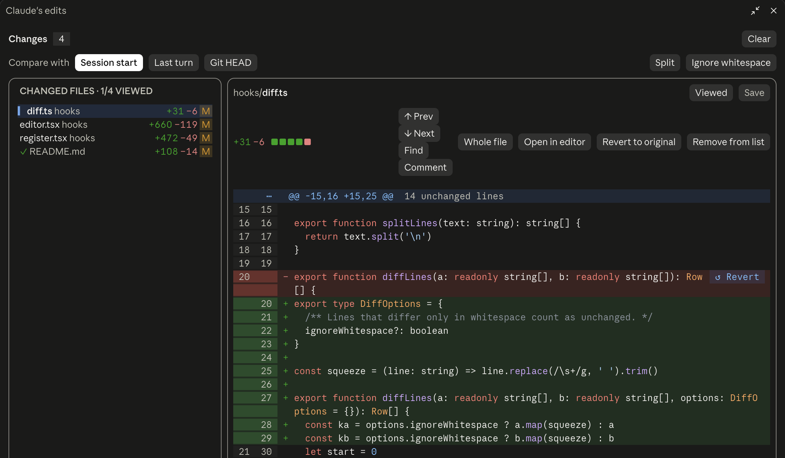

# editable-diff

A [Claude Code](https://claude.com/claude-code) mod that collects every file Claude changes into one panel and shows each as a diff you can edit in place, laid out like GitHub Desktop.

Review what Claude did, fix a line or two right in the diff, press Save, and Claude is told to re-read the file before its next edit. Or leave comments on the lines and send them to Claude in one message.



## Features

### The panel

- **Opens by itself** on Claude's first edit of the session, titled **Claude's edits**. Reopen it with `/editable-diff`.
- **A line above the prompt** while the panel is closed: `● Claude's edits · N files`, with **Open panel** and **Clear**, and a count of files with unsaved edits.
- **Toolbar.** The number of changed files, a chip with the number of unsaved ones, **Save all** when more than one file has unsaved edits, and **Clear** to empty the list. Clear asks first when unsaved edits would be lost, and never touches the files on disk.
- **Follows the theme.** The palette follows the light or dark theme set in Claude Code.

### Changed files list

- Every file Claude touched with Edit or Write, sorted by path, with its status (`A` added, `M` modified, `D` deleted), its folder, its `+N −N` counts, a dot for unsaved edits and a ✓ for files marked viewed.
- Pick a file with a click, or with the arrow keys once the list has the focus.
- The header counts how many files are viewed: `CHANGED FILES · 1/4 VIEWED`.
- **Remove from list** forgets one file; the file on disk stays as it is.

### The diff

- **GitHub style.** Old and new line numbers, `@@` hunk headers, tinted removed and added lines, the changed words marked within a changed line, and 5 lines of context around each change.
- **Syntax colours** for the language of the file, on the diff lines as on the context.
- **Hidden lines on demand.** Click a hunk header to show the unchanged lines it stands for, or press **Whole file** to see all of the file; **Changes only** goes back.
- **Unified or Split.** **Split** shows the old file on the left and the new one on the right, each change's removed lines beside its added ones. On a narrow panel it falls back to one column.
- **Ignore whitespace** treats lines that differ only in spaces and tabs as unchanged, so re-indented code drops out of the diff and the counts.
- **Compare with** chooses what the diff is drawn against:
  - **Session start**: the file as it was before Claude's first edit of it (the default).
  - **Last turn**: the file as Claude's last turn found it, so only what that turn did shows. A file the last turn did not touch says so.
  - **Git HEAD**: the file as committed. A file not yet committed compares with an empty one; outside a git repository the panel says so and uses the session start.
- **Long lines wrap** to the width of the panel instead of running off its edge.
- **Large diffs stay fast.** About 100 lines are drawn at a time, fewer when the lines are long. **Show next 50 lines** / **Show previous 50 lines** move the window, and so does the cursor.
- **Stats.** The file's `+N −N` and GitHub's five squares, the share of added and removed lines.

### Editing in place

- **A real editor in the diff.** Type into any added or unchanged line; the diff recolours as you type, so a line you edit turns into a change and a change you undo by hand goes back to plain.
- **Cursor and selection.** Click to place the cursor, drag to select, double-click a word, triple-click a line, Shift with the arrow keys.
- **Clipboard.** Copy, cut and paste; with nothing selected, copy and cut take the whole line.
- **Undo and redo**, indenting and outdenting the selected lines with Tab and Shift+Tab, and a new line keeps the indent of the one above.
- **Save** writes the file and adds a note to the conversation, so Claude reads the file again before it edits it next. **Discard my edits** drops them.
- **Files with unsaved edits stay open** in the background: switching files keeps their undo history and cursor.
- **Revert to original** (or **Undo last turn**, **Revert to HEAD**, after the base chosen) puts the whole file back as the base has it, as an unsaved edit you can still look over before saving.
- **↺ Revert** at the right end of a change's first line puts just that change back.

### Reviewing

- **Review comments.** Select lines (or place the cursor on one) and press **Comment** or Cmd/Ctrl+Enter, type what Claude should change, and press Enter. Commented lines get a dot in the diff. The comments gather in a **Review comments** card above the files, from any number of files; **×** drops one.
- **Send to Claude** sends them all as one message, each with its file, its lines and the lines quoted. **Put in prompt** puts the message in the prompt box instead, to add to it before sending. **Discard** drops them all.
- **Viewed.** Mark a file as reviewed: its diff folds away, the list ticks it, and the panel moves on to the next file left to review. The mark comes off by itself when the file changes again.
- **Next and previous change.** F7 / Shift+F7, or **↓ Next** / **↑ Prev**, move the cursor from change to change. Past the last change of a file they move on to the next file not yet viewed.
- **Find and replace.** Cmd/Ctrl+F opens a find bar over the diff with the matches marked and a count of them. A capital letter in the query makes it match case. Replace one match or all of them.
- **Open in editor** opens the file at the cursor line in VS Code, Cursor, Zed or Sublime Text, whichever is found first, else in the system's default app for it.

### In sync with the disk

- Changes made in another editor, by git or by a script show up within a second.
- A file changed back to how it was before Claude drops off the list.
- If a file changes on disk while you have unsaved edits in it, the panel asks whether to **Take the disk version** or **Keep mine**.
- A file deleted from disk is marked so; Save creates it again.

Syntax colours cover JavaScript/TypeScript, Python, Go, Rust, C/C++/Java/C#/Swift/Kotlin, shell, Ruby, YAML, TOML, JSON, CSS, SQL, HTML/XML and Markdown.

## Install

In Claude Code:

```
/plugin install editable-diff --marketplace tg-bomze/editable-diff
```

From a shell:

```bash
claude plugin install editable-diff --marketplace tg-bomze/editable-diff
```

In the desktop app: **+** next to the prompt → **Plugins** → **Add marketplace** `tg-bomze/editable-diff` → **Add plugin**.

## Usage

The panel, titled **Claude's edits**, opens by itself when Claude first edits a file. Reopen it with `/editable-diff` or **Open panel** above the prompt.

| Action | How |
| --- | --- |
| Save the file | **Save**, or Cmd/Ctrl+S in the editor |
| Save every file with edits | **Save all** |
| Drop your unsaved edits | **Discard my edits** |
| Put the file back as the chosen base has it | **Revert to original** / **Undo last turn** / **Revert to HEAD**, then **Save** |
| Put one change back | **↺ Revert** at the right end of the change |
| Choose what the diff is against | **Compare with**: **Session start**, **Last turn**, **Git HEAD** |
| Side by side / one column | **Split** / **Unified** |
| Hide re-indented lines | **Ignore whitespace** |
| Comment on the selected lines | **Comment**, or Cmd/Ctrl+Enter in the editor; type, then Enter |
| Send the comments | **Send to Claude**, or **Put in prompt** to edit the message first |
| Mark the file reviewed | **Viewed** |
| Go to the next / previous change | **↓ Next** / **↑ Prev**, or F7 / Shift+F7 |
| Open the file elsewhere | **Open in editor** |
| Show the whole file / only the changes | **Whole file** / **Changes only** |
| Forget a file | **Remove from list** |
| Forget every file | **Clear** (asks first if there are unsaved edits) |

Nothing is written to disk until you save. Removing or clearing only empties the list; files on disk stay as they are.

### Keys in the editor

| Keys | Does |
| --- | --- |
| Arrows, Home/End, Page Up/Down | Move; add Shift to select |
| Cmd/Ctrl+Left/Right, Cmd/Ctrl+Up/Down | Line start/end, file start/end |
| Cmd/Ctrl+A | Select all |
| Cmd/Ctrl+C / X | Copy / cut (the whole line when nothing is selected) |
| Cmd/Ctrl+Z, Cmd/Ctrl+Shift+Z or Cmd/Ctrl+Y | Undo, redo |
| Tab / Shift+Tab | Indent / outdent the selected lines |
| Cmd/Ctrl+Backspace | Delete to the line start |
| Cmd/Ctrl+S | Save |
| Cmd/Ctrl+Enter | Comment on the selected lines |
| F7 / Shift+F7 | Next / previous change, then the next file |
| Cmd/Ctrl+F | Find; again to close |

In the find bar: Enter and Shift+Enter (or Down and Up) go to the next and previous match, Tab moves between Find and Replace, Enter in Replace replaces the current match and Cmd/Ctrl+Enter replaces them all. A capital letter in the query makes it match case.

The editor takes the keys once you click in it.

## How it works

- The mod wraps Claude's Edit and Write tool calls. Before the first edit of a file it keeps the file's text: the session-start base, until the list is cleared. Before the first edit of a file in each turn it keeps the text again: the last-turn base.
- **Git HEAD** reads the committed file with `git show HEAD:<file>`, again every few seconds so a commit shows up. A file not yet committed compares with an empty one.
- Review comments go to Claude as a user message.
- Every second it checks the tracked files' size and modification time and reads any that changed.
- Saving writes the file and adds a note to the conversation, so Claude reads the file again before editing it.
- The list lives for the session.
- The palette follows the light or dark theme set in Claude Code.

## Limitations

- Editing works in the terminal and the desktop app. Other surfaces show the file list and buttons only.
- Only Edit and Write are tracked. Files changed by shell commands are not picked up.
- A file too large to hand to the editor (about 95,000 characters with its diff) is listed, but has to be edited elsewhere: **Open in editor**.
- A surface draws a limited tree, so the editor draws about 100 rows of a diff at a time, fewer for long lines. If a surface still cannot draw them, the editor tries again with half as many.
- Keys go to the editor only after a click in it, and some hosts keep F7 or Cmd+F for themselves: the buttons do the same.
- Very large rewrites (over 2 million line pairs) are drawn as one removed block followed by one added block.

## Development

Load the mod from a checkout:

```bash
claude --plugin-dir .
```

Validate, type-check and test:

```bash
claude plugin validate .
```

```bash
npx -y -p typescript@5.6.3 tsc -p . --noEmit --noUnusedLocals
```

```bash
claude plugin test .
```

The type definitions in `.claude-plugin/types/` are generated by Claude Code when the mod loads.

| File | Role |
| --- | --- |
| `hooks/register.tsx` | Tracks edits, polls the disk, saves, draws the panel and the line above the prompt |
| `hooks/editor.tsx` | The diff editor: layout, input, drawing |
| `hooks/files.tsx` | The changed files list |
| `hooks/diff.ts` | Line diff, word ranges, patches |
| `hooks/highlight.ts` | Syntax highlighting |
| `types/index.d.ts` | The mod's state types |
